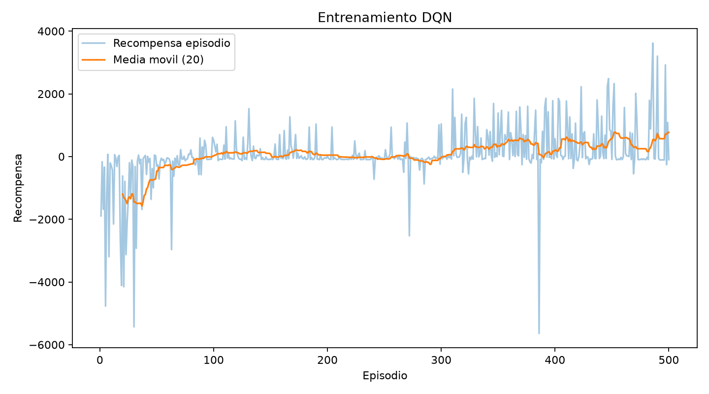
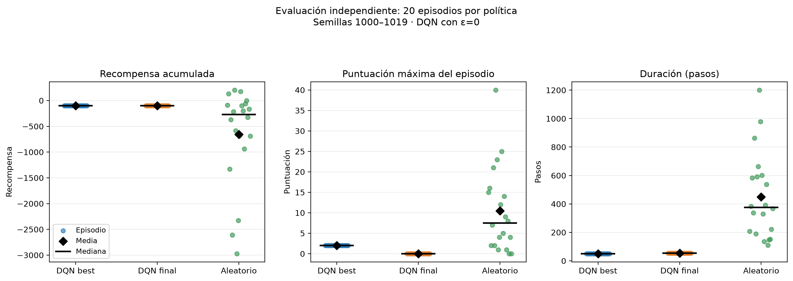
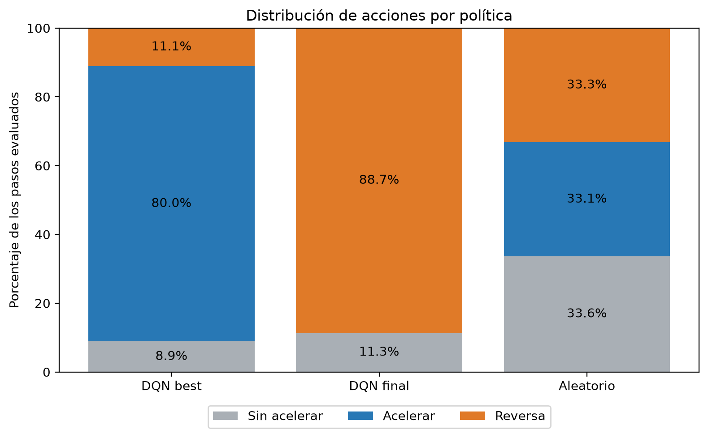

# Taller 2 — Deep Q-Network (DQN) en Hill Climb Racing

Proyecto académico de aprendizaje por refuerzo que entrena y evalúa un agente **DQN** en `hill_racing_env/HillRacing-v0`. El objetivo es aprender una política de control que permita progresar sobre un terreno con pendientes. **Resultado observado:** ninguno de los agentes evaluados completó el entorno en las 20 semillas de evaluación.

## Contenido

1. [Entorno y representación](#entorno-y-representación)
2. [Algoritmo y arquitectura](#algoritmo-y-arquitectura)
3. [Requisitos e instalación](#requisitos-e-instalación)
4. [Ejecución reproducible](#ejecución-reproducible)
5. [Resultados](#resultados)
6. [Documentación complementaria](#documentación-complementaria)
7. [Limitaciones y trabajo futuro](#limitaciones-y-trabajo-futuro)

## Entorno y representación

- Entorno: `hill_racing_env/HillRacing-v0` del proyecto [hillclimbracing](https://github.com/alexzh3/hillclimbracing).
- Configuración: acciones `discrete_3`, recompensa `distance`, modalidad `aggressive`, máximo 1200 pasos.
- Observación original: diccionario con posición (2), ángulo (1), velocidad de ruedas (2) y contacto con el suelo (2).
- Entrada al agente: vector `float32` de 7 elementos normalizados mediante `src/env_utils.py`.
- Acciones: 0 = sin acelerar; 1 = acelerar; 2 = reversa.
- Terminación: `terminated` o `truncated` finalizan el episodio; el bootstrap del target DQN se bloquea solo ante `terminated` según la implementación.

## Algoritmo y arquitectura

Red MLP `7 → 128 (ReLU) → 128 (ReLU) → 3 (lineal)`, con **17.923 parámetros**. Las salidas son valores Q, no probabilidades. El entrenamiento usa selección ε-greedy, replay buffer, red online y target, pérdida Huber y optimizador Adam.

`reset → normalizar observación → ε-greedy → step → guardar transición → muestrear minibatch → calcular Q online y target Bellman → Huber → backprop → sincronizar target periódicamente`.

La configuración oficial está en [`configs/dqn_main.yaml`](configs/dqn_main.yaml) y la justificación técnica en [`docs/README.md`](docs/README.md).

## Requisitos e instalación

Probado por el equipo con Python 3.12.x en Windows. Se recomienda crear un entorno virtual nuevo. El paquete del entorno utiliza dependencias nativas que en Windows pueden requerir **SWIG y herramientas de compilación C++**. Las versiones exactas usadas en las ejecuciones originales están registradas en `results/config.json` y en [`docs/resultados_actividad5.md`](docs/resultados_actividad5.md); `requirements.txt` utiliza rangos y no fija todas las versiones.

```powershell
git clone https://github.com/jddma/RL2.git
cd RL2
py -3.12 -m venv .venv
.\.venv\Scripts\Activate.ps1
python -m pip install --upgrade pip
python -m pip install -r requirements.txt
```

En Linux/macOS, crear el entorno con `python3.12 -m venv .venv` y activarlo con `source .venv/bin/activate`.

## Ejecución reproducible

Ejecutar **desde la raíz del repositorio** y con el entorno virtual activado:

**1. Inspección y pruebas:**

```powershell
python src/inspect_env.py
python -m pytest -q tests
```

**2. Prueba corta de integración (no reemplaza el experimento oficial):**

```powershell
python src/train.py --episodes 3 --learning-starts 10 --batch-size 4 --output results/smoke
```

**3. Entrenamiento oficial (500 episodios):**

```powershell
python src/train.py --config configs/dqn_main.yaml --output results
```

**Advertencia:** volver a entrenar con `--output results` sobrescribe archivos de entrenamiento existentes. Para preservar los resultados entregados, usa otra carpeta, por ejemplo `--output results/reproduccion`.

**4. Evaluación greedy y baseline (20 episodios, semillas 1000–1019):**

```powershell
python src/evaluate.py --policy dqn --checkpoint results/checkpoint_best.pt --episodes 20 --seed 1000 --output results/evaluation_best_v2
python src/evaluate.py --policy dqn --checkpoint results/checkpoint_final.pt --episodes 20 --seed 1000 --output results/evaluation_final_v2
python src/evaluate.py --policy random --episodes 20 --seed 1000 --output results/evaluation_random_v2
```

**5. Gráficas:**

```powershell
python src/plot_results.py --logs results/logs.csv --output assets/training_curve.png
python src/plot_evaluation.py
```

Las evaluaciones anteriores también sobrescriben los resultados existentes en esas carpetas. Para verificaciones independientes, cambia el argumento `--output`.

## Resultados

Los resultados corresponden a una ejecución de entrenamiento de 500 episodios y a 20 episodios de evaluación por política (semillas 1000–1019), según los artefactos incluidos.

| Métrica | DQN best | DQN final | Aleatorio |
|---|---:|---:|---:|
| Recompensa media | -98.026 | -97.064 | -657.990 |
| Progreso medio (score) | 2.00 | 0.00 | 10.45 |
| Pasos medios | 50.05 | 53.00 | 449.70 |
| Éxito | 0 % | 0 % | 0 % |
| Muerte | 100 % | 100 % | 95 % |







**Interpretación:** la mejora de recompensa no equivale a resolver el ambiente. Los checkpoints DQN murieron tempranamente en todos los episodios; el baseline aleatorio logró más progreso medio, aunque con recompensa muy variable. El checkpoint final eligió reversa en aproximadamente 88.68 % de los pasos y nunca aceleró durante esta evaluación. Más detalles y advertencias metodológicas en [`docs/resultados_actividad5.md`](docs/resultados_actividad5.md).

## Documentación complementaria

- [`docs/README.md`](docs/README.md): arquitectura e hiperparámetros (documento original del equipo).
- [`docs/evidencia_ejecucion_actividad5.md`](docs/evidencia_ejecucion_actividad5.md): evidencia de ejecución registrada por el equipo.
- [`docs/resultados_actividad5.md`](docs/resultados_actividad5.md): análisis experimental detallado.
- [`docs/challenges.md`](docs/challenges.md): retos y reflexión crítica integrada.
- [`docs/final_review.md`](docs/final_review.md): auditoría de archivos y checklist de validación.

## Limitaciones y trabajo futuro

Una sola corrida de entrenamiento, 20 episodios de evaluación por política y ausencia de éxito observado no permiten demostrar robustez ni convergencia. Se recomienda evaluar varios entrenamientos con semillas independientes, seleccionar checkpoints por validación greedy, estudiar la función de recompensa, añadir información anticipada del terreno y analizar trayectorias por paso. Las hipótesis requieren experimentación adicional.

## Autoría

Trabajo colaborativo del equipo del repositorio `jddma/RL2`. Añadir aquí nombres, roles y contribuciones **confirmados por los integrantes** antes de la entrega.
